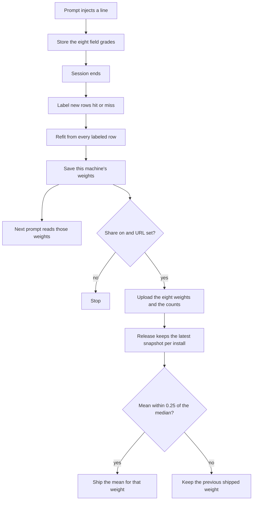

# User score model, local status page, and shipped defaults

*   **Author:** lawbringr
*   **Status:** Proposed
*   **Date:** 2026-11-12

--------------------------------------------------------------------------------

## Overview

Inscribe already keeps eight weights on each machine and moves them when a session ends. Those weights decide which memories a later prompt gets. This design makes that per-user model visible, lets the user opt in to contributing the weights alone, and defines how a later release turns contributed weights into the defaults that ship with the next version.

A person looks at the model on a page served only to this computer. Sharing stays off until they turn it on. Turning it on does not upload memories, prompts, or paths.

## The Problem

Prompt recall ranks memories with eight weights: text, key, body, type, scope, agent, command, and trajectory. When a prompt injects a line, Inscribe stores the match grades with the session. When the session ends, and again when the next session starts, a local pass labels that line. A later command that shares the memory and exits 0 is a hit. A failure, a correction, or a forgotten memory is a miss. Silence is ignored. Each weight that actually matched moves one step toward that label.

That pass is easy to miss. The weights live in one SQLite row. `inscribe score show` prints them as one line. There is no page, and there is no switch for sharing.

The weights also never leave the machine. A new install starts from fixed defaults checked into the binary. People who have already learned a useful row cannot contribute that row to the next release, even if they want to. People who do not want to contribute have no recorded choice, because the choice does not exist.

Two limits sit under the idea of "collect the weights and ship a better default":

*   A machine that already has a `score_model` row will keep using that row. Shipping a new default changes the starting point for a new install. It does not retrain anyone who has already had a session.
*   An average of opted-in rows can be pulled by one person who trained on thousands of lines, or by a row that drifted to an extreme. The draft has not yet said how that average is limited, or where the rows are collected.

## Goals

*   After a session ends, this user's weights include the new hit and miss labels, and the next prompt on this machine uses those weights in every project.
*   `inscribe serve` binds only to localhost and shows the eight weights, how many lines were seen, and the hit and miss counts.
*   The same page shows a share switch. The stored choice defaults to off.
*   With the switch off, no weight snapshot is queued and nothing is sent.
*   With the switch on, the queued record contains the eight weights, the seen, hit, and miss counts, and the Inscribe version. It does not contain prompt text, memory bodies, paths, or trajectory JSON.
*   A release step can turn uploaded snapshots into the default weights of the next version. Opening the database does not replace a stored row. The next refit starts from those defaults and replays this machine's labeled rows, so a long history stays near the old row and a short history moves toward the new defaults.

## Non-Goals

*   No model call and no network call on the hook path. Capture and prompt recall stay local.
*   No upload of memories, prompts, file paths, commands, or trajectory records.
*   No separate weight row per project or per agent. One row per machine.
*   The user's machine does not average other people's weights and does not download a new model between releases.
*   Session start and error lookup keep their current scoring. They do not use this weight row.
*   Consolidation stays off unless `consolidate.auto` is already true. This design does not turn it on.
*   This design does not build the server that receives uploads. The operator puts that URL in the global config. The client sends one weights snapshot to it.

## Open Questions

*   **Where do opted-in snapshots go?** Decided: when the share switch is on and `share.url` is set, the detached train process uploads the weights snapshot to that URL. The switch off, or an empty URL, sends nothing. A failed upload does not change stored weights and does not fail the hook. This design does not name the host. The operator does.
*   **How is the shipped average limited?** Decided: one latest snapshot per install. Mean of each weight, weighted by the label count and capped at 500. Median of each weight across installs. Ship the mean only when it is within 0.25 of the median. Otherwise keep the previous shipped weight.
*   **Does the per-user pass refit every labeled outcome, or keep the one step it takes today?** Decided: after new labels are applied, refit the eight weights from every labeled outcome this user has kept. Quiet rows are not fitted. The next prompt reads the refit row.

## Technical Plan

The model is eight weights on a gated score. The text grade, times the text weight, is the floor and is capped at 1. Each other field adds its weight times the gap only when that field's grade is above the floor. The sum is capped at 1. Recall then multiplies by confidence, recency, and scope, and injects at 0.35 or above. Training uses the capped sum, before confidence, recency, and scope. A hit pulls that sum toward 1. A miss pulls it toward 0. The step is `0.25 × (label − score) × field grade`. Text stays in `[0.5, 2]`. The other weights stay in `[0, 2]`.



### Local refit

`inscribe score train` already runs in a detached process on session start and on session end. The hook process still exits 0 before that work. The train process keeps today's labeling: a related command that exits 0 is a hit, a failure, correction, or forgotten memory is a miss, and silence stays unlabeled.

Weight writing changes. The process no longer applies one step to each new row and leaves the old row in place. It loads every outcome whose label is set, starting at the shipped defaults, and runs the same step in id order. It repeats for up to 8 passes and stops early when no weight moves by 0.001 or more. It recounts seen, hits, and misses from those rows, then saves `score_model`. Quiet rows stay out of the replay.

Starting from the weights already saved would count the same labels twice. Starting from the defaults in the binary means a later release can change the prior. Opening the database does not do that. Only the next refit does. A machine with hundreds of labels ends near its old row. A machine with a handful of labels moves toward the new defaults.

Rows labeled before this change have no stored prior. The first refit after the upgrade starts from the defaults in that binary and replays every labeled row once. Their previous one-step drift is dropped.

### Share upload

`~/.inscribe/config.toml` gains a global table:

```toml
[share]
analytics = false
url = ""
```

A project `.inscribe.toml` cannot set `share`. The loader ignores those keys the same way it ignores consolidate settings that only the global file may set.

The localhost page reads and writes `share.analytics` in that global file and leaves every other key as it was. `share.url` is edited by the operator, not by the page. The page shows whether the URL is empty. It does not need to reveal a URL that contains a token; it shows the host, or "empty".

On the first time analytics is turned on, the train process creates `install_id` in the meta table: a random 128-bit value, not a hostname and not a path. Later uploads reuse it.

After a saved refit, the train process uploads only when analytics is true and the URL is non-empty. The body is the install id, the Inscribe version, the eight weights, and the seen, hit, and miss counts. It does not include field grades, memory ids, prompts, paths, or trajectory JSON. The request times out after 3 seconds. Failure is logged. The saved weights stay. The hook has already exited.

### Local page

`inscribe serve` listens on `127.0.0.1:7331`. A flag can change the port. An address that is not a loopback address is refused. The page shows the eight weights, the seen, hit, and miss counts, the share switch, and whether a URL host is set. Turning the switch off stops later uploads. It does not delete an `install_id`.

### Release combine

`inscribe score combine` reads a directory of uploaded snapshot files. It is a maintainer command. Session end does not run it, and the user binary does not download other people's weights.

For each `install_id` it keeps the latest snapshot. For each weight it computes a mean weighted by `min(seen, 500)` and a median across installs. When the mean is within 0.25 of the median, that mean is the candidate. Otherwise the candidate stays at the previous shipped value. The command prints the eight candidates. A person updates `DefaultWeights` for the release. The command does not edit source files.

One install that has reached the clamps moves the mean, and the median check leaves that weight at the previous shipped value. One install with a huge history counts as 500, the same as an install that has 500 labels. Installs with no labeled rows are absent, because a refit that labeled nothing does not upload.

## Alternatives Considered

### Alternative A: Local queue, no upload

The session-end pass writes a weights file under the Inscribe home. A person copies those files onto a release machine.

*   **Pros**: Nothing leaves the machine on its own. An empty inbox cannot be called by accident.
*   **Cons**: The shipped defaults change only when someone collects the files. Machines that opted in and then went offline never arrive.
*   **Reason for Rejection**: Rejected by author: the share switch is supposed to send the snapshot to a URL in the global config. A queue that never sends does not do that.

### Alternative B: Share switch with no snapshot

The page stores the on or off choice and keeps it on the machine. No file is written and no request is sent.

*   **Pros**: The smallest change. A wrong URL cannot receive data because there is no send path.
*   **Cons**: A release has no rows to combine, so the shipped defaults stay the ones checked in today.
*   **Reason for Rejection**: Rejected by author: the point of the switch is to contribute this machine's weights to the next version.

### Alternative C: One step per new label

Each new hit or miss moves the eight weights once. Older labeled rows are not replayed.

*   **Pros**: This is what train does today. A second pass labels nothing new, and the work stays small at session end.
*   **Cons**: The saved history is not the model. Order and early clamps stick. A later shipped prior never meets the old labels again.
*   **Reason for Rejection**: Rejected by author: every labeled outcome this user has kept is part of the refit, not only the newest one.

### Alternative D: Mean of the weights, with no median check

The release takes one latest snapshot per install and ships the weighted mean of each weight.

*   **Pros**: A linear mix of the same eight weights is a real combined prior. Every opted-in install moves the result.
*   **Cons**: One install stuck on the clamps, or a few installs that disagree with everyone else, pulls a weight for every new install.
*   **Reason for Rejection**: Rejected by author: the mean is shipped only when it sits within 0.25 of the median. A weight that fails that check stays at the previous shipped value.

### Alternative E: Median of each weight, with no mean

The release ships the median of each weight across the latest snapshot per install.

*   **Pros**: One clamped install cannot pull the default. No label-count weight is required.
*   **Cons**: The eight medians can be a mix no install ever learned. An install with three labels counts the same as an install with 500. The label count, which the snapshot already carries, is ignored.
*   **Reason for Rejection**: Rejected by author: the median is the check, not the shipped value. The shipped value is the weighted mean when the check passes.

### Alternative F: A different model class

Replace the eight weights with another learner, such as a language model, an embedding index, or a classifier with its own feature set.

*   **Pros**: A different class could match paraphrases that the field grades miss.
*   **Cons**: Capture and prompt recall take no network call and no model call. A new class would change the hook path, the stored row, and what a snapshot is allowed to contain.
*   **Reason for Rejection**: Rejected by author: the local model and the shipped model are this gated scorer. The shipped row is a prior for the same eight weights.

### Alternative G: Pool field grades and refit one global model

Uploads include the eight field grades and the hit or miss label. The release replays every install's rows through one refit and ships that result.

*   **Pros**: This is a better fit for this scorer than averaging weights. The release sees the labels, not a row that may already sit on the cap of 1.
*   **Cons**: Field grades are derived from the prompt and from memory text. Shipping them shares more than the eight weights and the counts. A grade of 1 on command or trajectory is close to a specific command or path even when the text is left out.
*   **Reason for Rejection**: Rejected by author: the upload body is the install id, the version, the eight weights, and the counts. Field grades stay on the machine.

## Detailed Implementation Plan

No new dependency. HTTP uses the standard library. The hook process does not upload. `inscribe score train` is already spawned detached on session start and session end, and that process does the refit and the upload.

One behavior is tighter than the technical plan's sentence "upload after a saved refit." Turning the switch on must send the stored row at the next session boundary even when that pass has no new label. Refit still runs only when this pass labeled at least one row. Upload runs at the end of train when analytics is on, the URL is a usable http or https URL, and `seen > 0`.

### Target Files to Create/Modify

#### 1. `internal/config/config.go` (Modify)

*   **Type / Scope**: Config loader.
*   **Proposed Changes**: Add `Share ShareCfg` with `Analytics bool` (`share.analytics`) and `URL string` (`share.url`). In `overlayProject`, a project file that sets any `share` key is warned and ignored, the same way a project file cannot set consolidate. `Load` does not fail the process when the URL is malformed. The upload path checks the URL later.

#### 2. `internal/config/defaults.go` (Modify)

*   **Type / Scope**: Shipped defaults.
*   **Proposed Changes**: `share.analytics` defaults to false. `share.url` defaults to empty.

#### 3. `internal/config/config_test.go` (Modify)

*   **Type / Scope**: Config tests.
*   **Proposed Changes**: A global file with `analytics = true` and an https URL loads those values. A project file that sets `share.analytics` or `share.url` does not change the loaded config, and the warning says only the global file may set it.

#### 4. `internal/store/score_outcome.go` (Modify)

*   **Type / Scope**: SQLite reads.
*   **Proposed Changes**: Add `LabeledScoreOutcomes() ([]ScoreOutcome, error)`. It returns rows where `label IS NOT NULL`, ordered by `id` ascending, with the id, the features JSON, and the label. No row cap. Quiet rows stay out. The existing open-outcome query is unchanged.

#### 5. `internal/recall/refit.go` (Create)

*   **Type / Scope**: The local model.
*   **Proposed Changes**: `Refit(prior Weights, rows []Labeled) Weights`. `Labeled` is the parsed features and the label `0` or `1`. Start from `prior`. Visit rows in the given order. Apply the existing `learn` step. Repeat for up to 8 passes. Stop early when every weight changed by less than `0.001` in that pass. Set `Seen`, `Hits`, and `Misses` from the rows just replayed, not by adding to the prior's counts. `prior` is `DefaultWeights()` of the binary that is running.

#### 6. `internal/recall/train.go` (Modify)

*   **Type / Scope**: Idle pass.
*   **Proposed Changes**: Keep labeling open outcomes and resolving them, including quiet. Remove the per-row `learn` call that writes the saved weights. If this pass labeled at least one row, load every labeled outcome, `Refit` from `DefaultWeights()`, and `SaveWeights`. If this pass labeled nothing, leave the stored weights as they are. The result's hit and miss counts still describe this pass, so a second train on the same data reports zero newly labeled rows.

#### 7. `internal/recall/columns_test.go` (Modify)

*   **Type / Scope**: Train test.
*   **Proposed Changes**: `TestTrainLearnsFromWhatTheAgentDid` stops seeding `Key = 0.4` as the learned prior. After one train, key is above `1` and command is below `1`, because the replay starts at the defaults (`key = 1`, `command = 1`) and the fixture has one key hit and one command miss. A second train labels `0` and returns the same eight weights.

#### 8. `internal/recall/refit_test.go` (Create)

*   **Type / Scope**: Refit tests.
*   **Proposed Changes**: Two rows, hit then miss, match the fixture grades (`key` feature `0.5`, command feature `1`). `Refit` called twice from `DefaultWeights()` returns equal weights. A quiet-sized empty list returns the prior unchanged, with seen, hits, and misses set to `0`.

#### 9. `cmd/inscribe/snapshot.go` (Create)

*   **Type / Scope**: Upload body and release math.
*   **Proposed Changes**: A snapshot is JSON: `install_id` (string), `version` (string), `seen`, `hits`, `misses` (integers), and `weights` with `text`, `key`, `body`, `type`, `scope`, `agent`, `command`, `trajectory` (numbers). `PostSnapshot(url, snapshot)` sends that JSON with `Content-Type: application/json`, times out after 3 seconds, and returns the error to the caller. It adds no other header. `Combine(prior Weights, snaps []Snapshot) Weights` keeps the latest snapshot per `install_id` (later file modification time wins). For each weight, the mean is weighted by `min(seen, 500)` and the median is across installs. When `abs(mean-median) <= 0.25`, that weight becomes the mean. Otherwise it stays at `prior`. An empty install id is skipped.

#### 10. `cmd/inscribe/score.go` (Modify)

*   **Type / Scope**: `inscribe score`.
*   **Proposed Changes**: Usage becomes `inscribe score (train|show|combine)`. After a successful train, if `share.analytics` is true, `share.url` parses as an absolute http or https URL, and the stored `seen > 0`, create meta `install_id` with `crypto/rand` 16 bytes hex when it is missing, then `PostSnapshot`. A bad URL or a failed POST appends one line through the existing `inscribe.log` writer and still returns success for the train. `combine` reads a directory flag `--dir` (required). Each `*.json` file is one snapshot. The prior is `DefaultWeights()` in this binary. Print the eight weights with the same `writeWeights` line `score show` uses. Do not edit source files.

#### 11. `cmd/inscribe/serve.go` (Create)

*   **Type / Scope**: Local page.
*   **Proposed Changes**: `inscribe serve [--addr 127.0.0.1:7331]`. Parse the address. Refuse it unless the host is a loopback IP. Bind that address. On each request, refuse a `Host` that is not `127.0.0.1` or `localhost` with the bound port. `GET /` shows the eight weights, seen, hits, misses, the analytics switch, and the URL host or the word "empty". When analytics is on and the URL is not absolute http or https, the page says the URL is not usable. `POST /share` accepts `analytics=0` or `analytics=1`, rewrites only `share.analytics` in `~/.inscribe/config.toml`, and redirects to `/`. The rewrite parses the global file, sets that one key, and encodes the whole document back. If the global file is missing, write a file that contains only the `[share]` table. If the file does not parse, show the error and do not write. The page has no external assets and does not print `install_id` or the full URL.

#### 12. `cmd/inscribe/main.go` (Modify)

*   **Type / Scope**: Command dispatch.
*   **Proposed Changes**: Add `serve` to the usage string and dispatch it to `serveCmd`.

#### 13. `cmd/inscribe/serve_test.go` (Create)

*   **Type / Scope**: Page tests.
*   **Proposed Changes**: A non-loopback `--addr` returns an error and does not listen. A request whose `Host` is not loopback gets a refusal. `POST /share` with `analytics=1` against a temp home sets `share.analytics` and leaves a pre-existing `recall` key in that file unchanged. `POST` with `analytics=0` turns it off.

#### 14. `cmd/inscribe/snapshot_test.go` (Create)

*   **Type / Scope**: Upload and combine tests.
*   **Proposed Changes**: `PostSnapshot` against `httptest` sends the eight weights and the counts and does not send a memory id or a feature grade. `Combine` on two installs whose command weights are far apart keeps the prior command weight. `Combine` on two close command weights ships the weighted mean. Two files with the same `install_id` use the one with the later modification time.

#### 15. `README.md` (Modify)

*   **Type / Scope**: Command list.
*   **Proposed Changes**: Add `inscribe score train`, `inscribe score show`, `inscribe score combine --dir DIR`, and `inscribe serve [--addr 127.0.0.1:7331]` next to the other commands. State that serve binds to loopback, that share defaults to off, and that the upload body is the weights and the counts.

### Verification Plan

*   **Compilation/Build**: `go test ./internal/config ./internal/store ./internal/recall ./cmd/inscribe`
*   **Unit Tests**: The files in items 3, 7, 8, 13, and 14.
*   **Static Analysis & Linting**: `go test` covers the packages above. No new linter is added.
*   **Test Coverage Requirement**: The new branches are the ones in those tests: refit direction and stability, project config ignored, loopback and host refusal, toml key preserved, upload body, and the median check. A numeric coverage gate is not added.
*   **E2E/Integration**: The existing spawn test stays as it is. Session end still spawns `score` then `consolidate` for Claude Code, and Gemini still does not spawn consolidate. No new process is spawned for the upload.

### Files not changed

*   `cmd/inscribe/hook.go` stays as it is. It already spawns `score train`.
*   `internal/store/migrations/` gains no migration. `label` already exists.
*   `AGENTS.md` is left to the memory updater.
*   The architecture canvas is not part of this implementation list. Update it only if the page and the share path should be drawn there after the code lands.

--------------------------------------------------------------------------------

*Drafted with EGM*
